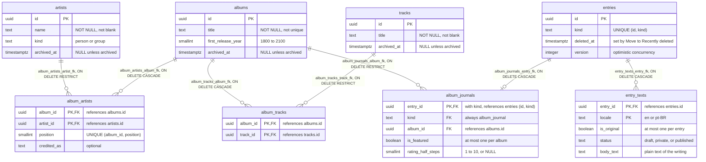

# Evidence: M4, academic demonstration kit

Prepared in M4.2 (issue #59), authorized by the owner on 2026-11-05 after the M4.1 readiness audit. It is the single place to prepare the academic presentation of November 16, 2026: what each academic requirement rests on in the code, an entity-relationship diagram, ready-to-paste SQL, a safe local environment, the demonstration itself, a provisional outline, and what M4.3 must capture.

**What this is not.** It is not the rehearsal. Nothing here is marked verified in the sense of [Requirements](../requirements.md#traceability): that column stays empty until the demonstration has been rehearsed end to end on a clean database (M4.3) and the owner has reviewed the evidence. Every record named below is synthetic (`[Test] Demo …`), lives only in the disposable test database, and is never the author's writing.

**Two open items, recorded and not resolved here:**

- **The original assignment document has not been located in the repository.** The requirements below are the project's own statement of them ([Requirements](../requirements.md#mandatory-requirements), AC-01 to AC-06). Nothing in this document adds to them or claims to quote the assignment.
- **The instructor has not confirmed** that the server side of one Next.js application (Server Actions and the domain modules behind them) satisfies their definition of "backend" ([Requirements § Notes on interpretation](../requirements.md#notes-on-interpretation)).

## Requirements matrix

| ID | Requirement | Evidence in one line | Status |
| --- | --- | --- | --- |
| AC-01 | A functional application using a real database | Next.js server, `pg` pool, PostgreSQL 17 in Docker Compose; data outlives an application restart | Implemented; automated tests pass in CI. No automated test restarts the application: that was checked once by script ([what was run](#what-was-run-for-this-document)) and is shown live. Not yet rehearsed (M4.3) |
| AC-02 | Two or more related tables with primary and foreign keys | 22 tables with declared keys; the eight in the [diagram](#entity-relationship-diagram) carry the demonstration | Implemented; automated tests pass in CI. Not yet rehearsed |
| AC-03 | Complete CRUD | Artists and albums created, read, updated, and physically deleted through the Studio; a journal created, moved to Recently deleted, and restored | Implemented; automated tests pass in CI. Not yet rehearsed |
| AC-04 | A query using `JOIN` | `albums ⋈ album_artists ⋈ artists` on the Albums page | Implemented; automated tests pass in CI. Not yet rehearsed |
| AC-05 | A query using a subquery or an aggregate | `COUNT … GROUP BY` ("2 tracks") and a correlated subquery ("used in 1 entry") on the same page; "1 of 2 tracks written" on the Desk | Implemented; automated tests pass in CI. The Desk's non-zero count is a test added in M4.2; its CI run is on the M4.2 pull request. Not yet rehearsed |
| AC-06 | Real frontend, backend, and database integration | Browser → Server Action → domain command → Drizzle → PostgreSQL, in both directions | Implemented; automated tests pass in CI. **The instructor's acceptance of "backend" is unconfirmed.** Not yet rehearsed |
| — | Local reproducibility (part of AC-01's evidence) | The [local environment runbook](#local-environment-runbook) on the disposable test database | Commands run once on 2026-11-05 (see [what was run](#what-was-run-for-this-document)); the full sequence has not been rehearsed |

"Automated tests pass in CI" means the named tests ran and passed in the repository's CI; the run for this branch is linked from its pull request. A live demonstration is a different claim, and none has been made yet.

### AC-01: a functional application using a real database

- **Implementation.** [`src/db/client.ts`](../../src/db/client.ts) (`getDb`: one `pg` `Pool`, wrapped by Drizzle); the schema in [`src/db/schema.ts`](../../src/db/schema.ts) and six versioned migrations in [`src/db/migrations/`](../../src/db/migrations/) (`0000` to `0005`); PostgreSQL `17.11` from [`compose.yaml`](../../compose.yaml).
- **Tables.** All of them; the demonstration uses the eight below.
- **Operation.** Every Studio page and action reads or writes PostgreSQL on the request; nothing is cached for the Studio.
- **UI.** The whole Writing Studio at `/studio`.
- **Tests.** [`client.integration.test.ts`](../../src/db/client.integration.test.ts), [`migrations.integration.test.ts`](../../src/db/migrations.integration.test.ts), and every browser test, which runs the production build against real PostgreSQL.
- **How to present.** Show the container (`docker compose --profile test ps`), make a record in the Studio, stop and restart the application server (not the database), reload: the record is still there.

### AC-02: related tables, primary and foreign keys

- **Implementation.** `artists`, `albums`, `album_artists`, `tracks`, `album_tracks`, `entries`, `entry_texts`, and `album_journals` in [`schema.ts`](../../src/db/schema.ts); the constraints are declared in PostgreSQL, not only in TypeScript ([migration `0000`](../../src/db/migrations/0000_relational_domain.sql)).
- **Operation.** Primary keys (single and composite), foreign keys with `ON DELETE CASCADE` or `RESTRICT`, `UNIQUE`, and `CHECK` constraints.
- **UI.** Indirect: a refused delete in the Studio is PostgreSQL's `RESTRICT` (AC-03).
- **Tests.** [`migrations.integration.test.ts`](../../src/db/migrations.integration.test.ts) and [`catalog.integration.test.ts`](../../src/db/catalog.integration.test.ts) (each rejection checked by SQLSTATE and constraint name), [`entries.integration.test.ts`](../../src/db/entries.integration.test.ts).
- **How to present.** The [diagram](#entity-relationship-diagram), then [SQL E](#e-keys-and-a-refused-delete) in `psql`.

### AC-03: complete CRUD

- **Implementation.** [`src/modules/catalog/commands.ts`](../../src/modules/catalog/commands.ts): `createArtist`, `updateArtist`, `deleteArtist`, `createAlbum` (album, reference edition, and credits in one transaction), `updateAlbum`, `deleteAlbum`, `createTrack`, `addTrackToAlbum`, `deleteTrack`. [`src/modules/journals/commands.ts`](../../src/modules/journals/commands.ts): `createAlbumJournal`, `saveAlbumJournal`, `deleteAlbumJournal`, `restoreAlbumJournal`. Reads in [`catalog/queries.ts`](../../src/modules/catalog/queries.ts) and [`journals/queries.ts`](../../src/modules/journals/queries.ts).
- **Tables.** `artists`, `albums`, `album_editions`, `album_artists`, `tracks`, `album_tracks`, `edition_tracks`; `entries`, `entry_texts`, `album_journals`, `entry_slugs`, `track_reflections`, `track_reflection_texts`.
- **Operation.** Drizzle's query builder: `insert(...).values(...).returning(...)`, `update(...).set(...)`, `delete(...).where(...)`, inside `db.transaction` where a write spans tables.
- **What "delete" means, exactly.**
  - **Artists, albums, tracks:** a real SQL `DELETE` (`deleteArtist`, `deleteAlbum`, `deleteTrack`). PostgreSQL refuses it when a foreign key declared `ON DELETE RESTRICT` refers to the record: an artist's credits; a track's album membership or a memory link; an album's journals or memory links. The record's own rows go with it (`CASCADE`): an album's credits, tracklist membership, and edition; a track's credits. On a refusal the Studio says why ("It is credited on an album.", "Journals are written about it, so it stays in your catalog.").
  - **Journals:** *Move to Recently deleted* is an `UPDATE entries SET deleted_at = now()` (`deleteAlbumJournal`). Nothing is physically deleted, and *Restore* clears the column again. **It must not be presented as a `DELETE`.**
  - **"Delete now"** (permanent deletion of writing, M2.4) is **not built** in the Studio. The command `permanentlyDeleteEntry` exists and only tests call it.
- **UI.** `/studio/artists` and `/studio/artists/<id>` (*Add an artist*, *Save artist*, *Delete artist…*); `/studio/albums` and `/studio/albums/<id>` (*Add an album*, *Save album*, *Create and add*, *Delete album…*); `/studio/journals/<id>` (*Move to Recently deleted…*); `/studio/journals/deleted` (*Restore…*).
- **Tests.** [`e2e/catalog.spec.ts`](../../e2e/catalog.spec.ts) (create, read after reload, update, the real `DELETE` and the refusal, each checked in PostgreSQL), [`e2e/recovery.spec.ts`](../../e2e/recovery.spec.ts) (soft delete and restore), [`commands.integration.test.ts`](../../src/modules/catalog/commands.integration.test.ts), [`journals.integration.test.ts`](../../src/modules/journals/journals.integration.test.ts), [`restore.integration.test.ts`](../../src/modules/journals/restore.integration.test.ts), and every action over HTTP in [`studio-actions.http.test.ts`](../../src/testing/studio-actions.http.test.ts).
- **How to present.** [The CRUD demonstration](#crud-demonstration), with [SQL D](#d-crud-persistence) after each step.

### AC-04: a query using `JOIN`

- **Implementation.** `listAlbumsWithArtists` in [`catalog/queries.ts`](../../src/modules/catalog/queries.ts), written with Drizzle's `sql` template, so the SQL text in the source is the SQL PostgreSQL runs.
- **Tables.** `albums ⋈ album_artists ⋈ artists`, joined on the two foreign keys of the junction table.
- **UI.** The Albums page, `/studio/albums` (in the Studio's Catalog section): each row names the album's credited artists. Several credits arrive as several rows, and the page joins their names with a comma in TypeScript; the join itself is SQL.
- **Tests.** [`catalog/queries.integration.test.ts`](../../src/modules/catalog/queries.integration.test.ts) (`listAlbumsWithArtists (AC-04, JOIN)`); [`e2e/academic.spec.ts`](../../e2e/academic.spec.ts) (a JOIN across the related tables, and the artist on the page).
- **How to present.** The Albums page, then [SQL A](#a-join-albums-with-their-credited-artists) in `psql`: the same rows.

### AC-05: a subquery or an aggregate

- **Implementation.** In [`catalog/queries.ts`](../../src/modules/catalog/queries.ts): `listAlbumTrackCounts` (`COUNT` with `GROUP BY` over a `LEFT JOIN`) and `listAlbumUsage` (a correlated subquery with `IN` subqueries). In [`journals/queries.ts`](../../src/modules/journals/queries.ts): `listAlbumJournalProgress` (the Desk's "n of N tracks written": `COUNT` and `GROUP BY` with a scalar subquery) and `getJournalStatistics` (`COUNT … FILTER`). Each count is computed by PostgreSQL; none is a JavaScript count of fetched rows.
- **Tables.** `albums`, `album_tracks`; `entries`, `album_journals`, `memory_music`; for the Desk, also `entry_texts`, `album_editions`, `edition_tracks`, `track_reflections`, `track_reflection_texts`.
- **UI.** `/studio/albums`: "2 tracks" and "used in 1 entry". The Desk, `/studio`: "1 of 2 tracks written" beside the journal, and the journals by status above the list (for the demonstration's one draft, "1 journal: 1 draft, 0 private, 0 published.").
- **Tests.** [`commands.integration.test.ts`](../../src/modules/catalog/commands.integration.test.ts) (`counts tracks per album once, however many credits the album has`), [`queries.integration.test.ts`](../../src/modules/catalog/queries.integration.test.ts) (`listAlbumUsage (AC-05, subquery)`), [`journals/queries.integration.test.ts`](../../src/modules/journals/queries.integration.test.ts) (what counts as written); [`e2e/academic.spec.ts`](../../e2e/academic.spec.ts) (the page and the SQL agree; and, since M4.2, the Desk reads "1 of 2 tracks written" after one reflection is saved, matching a count in SQL).
- **How to present.** The same Albums page, then [SQL B](#b-count-with-group-by-tracks-on-each-album) and [SQL C](#c-correlated-subquery-entries-that-use-each-album). The Desk's figure is optional ([SQL F](#f-optional-the-desks-tracks-written)): its query is correct but too long to explain in a minute.

### AC-06: frontend, backend, and database integration

- **Implementation.** One request, creating an album:
  1. [`album-form.tsx`](../../src/app/studio/albums/album-form.tsx), a client component, calls the Server Action `createAlbumAction(payload)` on submit.
  2. [`albums/actions.ts`](../../src/app/studio/albums/actions.ts): the action is a public `POST` endpoint. It first calls `authorizeAuthor` ([`identity/authorization.ts`](../../src/modules/identity/authorization.ts)), which checks the author's session in the database.
  3. `perform` ([`studio/perform.ts`](../../src/app/studio/perform.ts)) checks that the request's `Origin` is the application's own, runs the command, and turns a failure into a fixed code.
  4. `createAlbum` ([`catalog/studio.ts`](../../src/modules/catalog/studio.ts) binds it to the database) validates the input with Zod (`albumInput` in [`catalog/input.ts`](../../src/modules/catalog/input.ts)), then writes the album, its reference edition, and its credits in one transaction.
  5. Drizzle sends the SQL through the `pg` pool ([`db/client.ts`](../../src/db/client.ts)) to PostgreSQL.
  6. The action returns `{ ok: true, data: { id } }`; the form navigates to `/studio/albums/<id>`, a Server Component that queries PostgreSQL again for that request.
- **The backend.** The server side of the Next.js application: Server Actions and route handlers run only on the server, and only server modules can import the database client (a lint rule enforces it, [Architecture](../architecture.md)). There is no separate API server, and none is added for the presentation. Whether this meets the course's definition of "backend" is the open item above.
- **Tests.** [`e2e/academic.spec.ts`](../../e2e/academic.spec.ts) (an `UPDATE` made in SQL appears in the interface after a reload); [`e2e/catalog.spec.ts`](../../e2e/catalog.spec.ts) (each change made in the interface is read back from PostgreSQL); [`studio-actions.http.test.ts`](../../src/testing/studio-actions.http.test.ts) (every action over real HTTP, refused without the author's session, with a checksum proving nothing was written).
- **How to present.** An edit in the browser, then the row in `psql`; an `UPDATE` in `psql`, then a reload ([CRUD demonstration](#crud-demonstration), step 10).

## Entity-relationship diagram

The demonstration subset: the catalog that the Albums page shows, and the album journal that points at it. Keys, constraint names, and delete rules are those of [`schema.ts`](../../src/db/schema.ts) and the migrations, read back from PostgreSQL's catalog for this document. Cardinalities are what the constraints allow; where a rule is enforced by the command that writes the rows rather than by a constraint, the note says so.



How to read it, in the order of the presentation:

- **Many-to-many through a junction table.** An album can credit several artists, and an artist can appear on many albums. `album_artists` holds one row per pair; its primary key is the pair itself (`album_artists_pkey (album_id, artist_id)`), so the same artist cannot be credited twice on one album, and `album_artists_position_unique (album_id, position)` keeps the credits in order. `album_tracks` does the same for albums and recordings (a recording can belong to several albums).
- **Two delete rules, on purpose.** A junction row belongs to its album: deleting the album deletes its credits and memberships (`CASCADE`). The other side is `RESTRICT`: an artist that is credited, or a recording that is on an album, cannot be deleted. Anything the author wrote refers to the catalog with `RESTRICT` (`album_journals_album_fk`), so a catalog `DELETE` can never remove writing.
- **A supertype and a subtype.** `entries` holds what every kind of writing shares (the deletion mark and the version used to refuse stale saves); `album_journals` is the album-journal kind. Its primary key is also its foreign key, so an entry has at most one album-journal row (`||--o|`). Its foreign key, `album_journals_entry_fk`, is `(entry_id, kind)` and points at `entries_id_kind_unique (id, kind)`, so an album-journal row can only belong to an entry whose kind is `album_journal`.
- **Language versions.** `entry_texts` has one row per language (`entry_texts_pkey (entry_id, locale)`), each with its own visibility. A partial unique index, `entry_texts_one_original_idx`, allows at most one original; the command that creates an entry writes exactly one in the same transaction (the constraint alone allows zero).
- **What constraints do not say.** An album has at least one credited artist and exactly one reference edition because `createAlbum` and `updateAlbum` write them that way inside one transaction, not because of a constraint ([Data Model § Rules not enforced by constraints](../data-model.md#rules-not-enforced-by-constraints)). The diagram therefore shows `o{` (zero or more), which is what PostgreSQL itself enforces.

**Left out, deliberately.** The schema has 22 tables in `public` ([Data Model](../data-model.md#relationships)). Not drawn: `album_editions` and `edition_tracks` (the reference edition and track order; the Desk's "of 2 tracks" counts the reference edition's rows); `track_artists`; `track_reflections` and `track_reflection_texts` (writing per track, which refers to `album_tracks` with `RESTRICT`, so a recording that has a reflection cannot be taken off its album); `artist_journals`, `memories`, and `memory_music` (the other kinds of writing); `entry_slugs` (public addresses); and the five `auth_*` tables of the single author account. They follow the same rules, and adding them would hide the shape the requirements ask about.

## SQL evidence

Each block is labeled:

- **Exact production SQL** is copied from the function named, whitespace aside. Run on the demonstration database, it returns what the page shows.
- **Written for the demonstration** is SQL written for this document, to show a row's state or a rule; it is not used by the application.
- **Catalog inspection** is a PostgreSQL or `psql` command that describes the schema.

Open `psql` on the **disposable test database only** (it has fixed, local-only credentials in `compose.yaml`):

```sh
docker compose --profile test exec postgres-test psql -U refrain_test -d refrain_test
```

Start every `psql` session with this check, and quit (`\q`) unless it prints `refrain:disposable-test-database`. The development container (`postgres`) holds real writing and must never be on screen:

```sql
select shobj_description(oid, 'pg_database') from pg_database where datname = current_database();
```

The exact production queries list every album in the database they run on, which is why they are run only here. All of them were run on that database for this document, against the schema of migrations `0000` to `0005` ([what was run](#what-was-run-for-this-document)).

### A. JOIN: albums with their credited artists

Exact production SQL: `listAlbumsWithArtists` in [`catalog/queries.ts`](../../src/modules/catalog/queries.ts). It backs the artist names on `/studio/albums`.

```sql
select al.id, al.title, al.first_release_year,
       coalesce(aa.credited_as, ar.name) as artist_name, aa.position
  from albums al
  join album_artists aa on aa.album_id = al.id
  join artists ar       on ar.id = aa.artist_id
 where al.archived_at is null
 order by al.title, al.id, aa.position;
```

Expected: one row per credit. For the demonstration album, one row with `[Test] Demo Artist` at position 1.

### B. COUNT with GROUP BY: tracks on each album

Exact production SQL: `listAlbumTrackCounts` in [`catalog/queries.ts`](../../src/modules/catalog/queries.ts). It backs "2 tracks" on `/studio/albums`.

```sql
select al.id, al.title, al.first_release_year,
       al.archived_at is not null as archived,
       count(m.track_id)::int as track_count
  from albums al
  left join album_tracks m on m.album_id = al.id
 group by al.id
 order by al.title, al.id;
```

Expected: `track_count = 2`. The `LEFT JOIN` keeps an album with no tracks (it reads 0), and only one one-to-many table is joined, so the count is not multiplied by the credits.

### C. Correlated subquery: entries that use each album

Exact production SQL: `listAlbumUsage` in [`catalog/queries.ts`](../../src/modules/catalog/queries.ts). It backs "used in 1 entry" on `/studio/albums`.

```sql
select al.id, al.title,
       (select count(*)::int
          from entries e
         where e.deleted_at is null
           and (   e.id in (select aj.entry_id  from album_journals aj where aj.album_id = al.id)
                or e.id in (select mm.memory_id from memory_music mm  where mm.album_id = al.id))
       ) as used_in
  from albums al
 where al.archived_at is null
 order by al.title, al.id;
```

Expected: `used_in = 0` before the journal is written, `1` after, and `0` again while the journal is in Recently deleted. The inner `select` runs once per album row (`al.id` comes from the outer query), which is what makes it correlated.

### D. CRUD persistence

Written for the demonstration. Run one after each step of the [CRUD demonstration](#crud-demonstration):

```sql
-- Create and update: the artists and albums as stored.
select name, kind, created_at, updated_at from artists
 where name like '[Test] Demo%' order by created_at;
select title, first_release_year, created_at, updated_at from albums
 where title like '[Test] Demo%' order by created_at;

-- Delete: before and after the real DELETE of the unused artist (1, then 0).
select count(*) from artists where name = '[Test] Demo Unused Artist';

-- Move to Recently deleted and Restore: an UPDATE of entries.deleted_at.
select al.title as album, e.deleted_at is not null as in_recently_deleted,
       o.status, e.version
  from album_journals aj
  join entries e     on e.id = aj.entry_id
  join entry_texts o on o.entry_id = e.id and o.is_original
  join albums al     on al.id = aj.album_id
 where al.title like '[Test] Demo%';
```

### E. Keys, and a refused delete

Catalog inspection:

```sql
\d album_artists

select conname, contype, pg_get_constraintdef(oid) as definition
  from pg_constraint
 where conrelid = 'album_artists'::regclass
 order by contype desc, conname;
```

Expected (the second query):

```text
            conname            | contype |                            definition
-------------------------------+---------+-------------------------------------------------------------------
 album_artists_position_unique | u       | UNIQUE (album_id, "position")
 album_artists_pkey            | p       | PRIMARY KEY (album_id, artist_id)
 album_artists_album_fk        | f       | FOREIGN KEY (album_id) REFERENCES albums(id) ON DELETE CASCADE
 album_artists_artist_fk       | f       | FOREIGN KEY (artist_id) REFERENCES artists(id) ON DELETE RESTRICT
 album_artists_position_check  | c       | CHECK (("position" >= 1))
```

Written for the demonstration: a `DELETE` that PostgreSQL refuses, inside a transaction that is rolled back either way, so nothing can change:

```sql
begin;
delete from artists where name = '[Test] Demo Artist';
rollback;
```

Expected:

```text
ERROR:  update or delete on table "artists" violates foreign key constraint "album_artists_artist_fk" on table "album_artists"
DETAIL:  Key (id)=(…) is still referenced from table "album_artists".
```

This is the same refusal the Studio turns into "It is credited on an album." Use the artist's current name if it was renamed in step 10.

Written for the demonstration, after step 8: writing refers to the catalog with `RESTRICT`, so the album that a journal is about cannot be deleted either (the Studio says "Journals are written about it, so it stays in your catalog."):

```sql
begin;
delete from albums where title like '[Test] Demo Album%';
rollback;
```

Expected:

```text
ERROR:  update or delete on table "albums" violates foreign key constraint "album_journals_album_fk" on table "album_journals"
```

Written for the demonstration: an insert that a foreign key refuses, because neither the album nor the artist exists:

```sql
begin;
insert into album_artists (album_id, artist_id, position)
values (gen_random_uuid(), gen_random_uuid(), 1);
rollback;
```

Expected:

```text
ERROR:  insert or update on table "album_artists" violates foreign key constraint "album_artists_album_fk"
```

### F. Optional: the Desk's tracks written

The Desk's figure comes from `listAlbumJournalProgress` in [`journals/queries.ts`](../../src/modules/journals/queries.ts), whose exact SQL is quoted in [Data Model § Representative SQL](../data-model.md#representative-sql) (too long for the presentation). A track counts as written when its reflection has non-empty text in the journal's original language and is not marked "still writing".

Written for the demonstration: a simplified count over the same rows, narrowed to one album, the same as [`e2e/academic.spec.ts`](../../e2e/academic.spec.ts) compares with the Desk. It leaves out two filters of the production query, the restriction to the reference edition's tracks and `e.deleted_at is null`, so it agrees with the Desk only while the journal is not deleted and its tracks are on the reference edition, as in the demonstration:

```sql
select count(trt.track_reflection_id)::int as tracks_written
  from albums al
  join album_journals aj on aj.album_id = al.id
  join entry_texts o     on o.entry_id = aj.entry_id and o.is_original
  join track_reflections tr on tr.album_journal_id = aj.entry_id
  join track_reflection_texts trt on trt.track_reflection_id = tr.id
                                 and trt.locale = o.locale
                                 and trt.body_text <> ''
                                 and not tr.is_still_writing
 where al.title like '[Test] Demo Album%';
```

## Local environment runbook

The demonstration runs on the **disposable test database** (`postgres-test`, port 5433) with a **synthetic author**, the production build, and `next start` on `127.0.0.1:3400`. It never reads or writes the development database or the owner's account, it uses the supported author command and the normal sign-in form, and it adds no bypass of any kind.

The presentation of 2026-11-16 shows the Studio and the public pages, both from this local server. Public reads are on in the demonstration terminal only, and the server listens on `127.0.0.1`, so the pages can be opened from this computer alone. This is not a publication: nothing is hosted or deployed, the switch is never enabled on a reachable host, and gates G1 to G8 stay open. The steps below cover the Studio; publishing a synthetic journal and opening its public page are added in the rehearsal (M4.3). Until then nothing is published, and the public pages show what an empty journal shows.

Know these before you start:

- **The test database lives in memory (`tmpfs`).** Stopping or recreating the `postgres-test` container discards every row, including the demonstration records and the author. Restarting the *application* keeps them; restarting the *database container* does not. If Docker Desktop restarts, start again at step 3.
- **The secret must stay the same across application restarts.** Sessions are signed with `BETTER_AUTH_SECRET`; restarting the server with a new one signs the author out. The runbook generates one throwaway secret per demonstration terminal and reuses it.
- **Sign-in allows five attempts a minute, for everyone together.** Sign in once before presenting. If the page says "Too many attempts. Wait a minute, then try again.", wait a minute.
- **Use exactly `http://127.0.0.1:3400`.** It must equal `BETTER_AUTH_URL`; Server Actions refuse a request whose `Origin` is anything else (`perform` calls `hasTrustedOrigin` from [`identity/authorization.ts`](../../src/modules/identity/authorization.ts)), and `localhost` is a different origin.
- **Tests and the demonstration cannot share the database.** The HTTP and browser test setups refuse to start while the identity tables hold an account, and the browser tests' teardown removes `[Test] E2E …` records. Run every test first, then recreate the database, then prepare the demonstration.
- **The build fetches Google Fonts.** `next/font/google` downloads Kalam and Alegreya Sans during `pnpm build` and serves them from the build, so the browser never contacts Google. Build while online. The built output was checked to contain no Google Fonts address; a run with the network off has **not** been done (M4.3).
- **No external provider is needed.** Records are entered by hand. Do not open *Add music* or artist photographs during the presentation: they call MusicBrainz, the Cover Art Archive, and Wikimedia Commons.

### 1. Prerequisites, while online

```sh
node --version                    # v24.22.2 (.nvmrc); switch with your version manager if not
pnpm --version                    # 12.15.0
pnpm install --frozen-lockfile
docker info --format '{{.ServerVersion}}'                            # Docker is running
docker image inspect postgres:17.11-trixie --format '{{.RepoTags}}'   # present locally
pnpm exec playwright install chromium                               # for the browser tests
node --env-file=.env -e 'for (const v of ["POSTGRES_PASSWORD", "TEST_DATABASE_URL"]) console.log(v, process.env[v]?.trim() ? "set" : "MISSING")'
lsof -nP -iTCP:3400 -iTCP:3410 -sTCP:LISTEN                         # prints nothing: both ports free
```

`.env` must exist: Docker Compose reads `POSTGRES_PASSWORD` from it even for the test service, and step 4 reads `TEST_DATABASE_URL` from it (the check above prints names, never values). If the image is missing, `pnpm db:test:up` pulls it; do that while online.

### 2. Run the automated tests

In the repository's usual terminal, with your normal `.env`:

```sh
pnpm db:test:down && pnpm db:test:up      # a clean, marked, disposable database
pnpm lint && pnpm format:check && pnpm typecheck && pnpm test
pnpm test:integration
pnpm build
pnpm test:http
pnpm test:e2e:run                         # needs port 3410 free
```

Record each result. A failure is a blocker for the presentation, not something to work around.

### 3. Recreate the disposable database

```sh
pnpm db:test:down && pnpm db:test:up
```

### 4. Open the demonstration terminal

Open a **new** terminal at the repository root, used only for the demonstration. Every command this runbook types there targets the test database. (It does not fence the terminal: `pnpm db:up` or `docker compose exec postgres …` would still address the development container, so never type them there.) The values are never printed.

```sh
export PS1="[DEMO test-db] $PS1"                         # tells this terminal apart
export DATABASE_URL="$(grep -E '^TEST_DATABASE_URL=' .env | cut -d= -f2-)"
export BETTER_AUTH_SECRET="$(openssl rand -base64 32)"   # throwaway, for this terminal only
export BETTER_AUTH_URL=http://127.0.0.1:3400
export REFRAIN_AUTHOR_EMAIL=author@example.com
export REFRAIN_PUBLIC_READS_ENABLED=true                 # local only: this server listens on 127.0.0.1
export NEXT_TELEMETRY_DISABLED=1                         # as CI and the test servers do
# The providers point at a closed local port, so an accidental click on Add music
# or an artist photograph fails closed instead of calling the real services.
export REFRAIN_MUSICBRAINZ_BASE_URL=http://127.0.0.1:9/
export REFRAIN_COVER_ART_ARCHIVE_BASE_URL=http://127.0.0.1:9/
export REFRAIN_WIKIMEDIA_COMMONS_BASE_URL=http://127.0.0.1:9/
export REFRAIN_WIKIDATA_BASE_URL=http://127.0.0.1:9/

# demo_ok: succeeds only if DATABASE_URL itself reaches the database that carries
# the disposable-test marker. It reads one row and prints no connection detail.
demo_ok() {
  node -e '
    const { Client } = require("pg");
    const client = new Client({ connectionString: process.env.DATABASE_URL });
    client.connect()
      .then(() => client.query("select shobj_description(oid, $$pg_database$$) as marker from pg_database where datname = current_database()"))
      .then((result) => { if (result.rows[0]?.marker !== "refrain:disposable-test-database") { console.error("Not the disposable test database. Stop."); process.exitCode = 1; } else { console.log("Disposable test database."); } })
      .catch(() => { console.error("Cannot reach the test database. Stop."); process.exitCode = 1; })
      .finally(() => client.end());'
}
demo_ok
```

Variables set here take precedence over `.env`, which the application and the commands still read for anything not set. Continue only if `demo_ok` prints `Disposable test database.` Every command below that writes is prefixed with `demo_ok &&`, so it does not run anywhere else.

### 5. Create the schema and the synthetic author

```sh
demo_ok && pnpm db:migrate
docker compose --profile test exec -T postgres-test psql -U refrain_test -d refrain_test -XAtc "select count(*) from drizzle.__drizzle_migrations"   # 6
demo_ok && pnpm author:provision --target=127.0.0.1:5433/refrain_test
```

The migration creates the tables in the freshly recreated database; the count proves it was that database (six migrations, `0000` to `0005`). The author command refuses unless the target matches `DATABASE_URL`, prints the database and `author@example.com`, then asks for a password twice without showing it. Choose a test password of 15 to 128 characters that does not contain the email, and keep it out of the slides, the repository, and any recording. It belongs to a synthetic account in a database that is discarded afterwards.

### 6. Build and start

```sh
pnpm build                                     # skip if step 2's build is from the same commit
demo_ok && pnpm exec next start -H 127.0.0.1 -p 3400
```

To restart the application during the presentation, press Ctrl-C and run **only the `next start` line** again **in the same terminal**: the secret is unchanged, so the author stays signed in and every record is still there. Closing the terminal loses the secret: in a new demonstration terminal (step 4 again), the author signs in again, within the five attempts a minute.

### 7. Sign in

Open `http://127.0.0.1:3400/studio`, sign in as `author@example.com` with the password from step 5, and check that the Desk appears.

### 8. Enter the synthetic records

Follow [the CRUD demonstration](#crud-demonstration) once, as a rehearsal, or enter only the starting records you want to exist before the talk. Use `[Test] Demo …` names only.

### 9. Rehearse and capture

Rehearse with the [outline](#presentation-outline-provisional), and capture what the [M4.3 checklist](#m43-evidence-checklist) lists into `visual-review/m4/`, which Git ignores. No screenshot is committed without the owner's authorization.

### 10. Clean up, only after the evidence is safe

When the captures are saved and checked, stop the server (Ctrl-C), close the demonstration terminal (its secret goes with it), and discard the database: `pnpm db:test:down`. Do this after the presentation too, not before it.

## CRUD demonstration

The smallest reliable sequence for the presentation. Every step uses only the Studio and `psql`; nothing calls an external service. Edit each record in **one tab**: catalog records are last-write-wins ([Roadmap](../roadmap.md#catalog-edit-concurrency-last-write-wins)).

| # | In the Studio | What it shows | Check in `psql` |
| --- | --- | --- | --- |
| 1 | Artists → *Add an artist*: Name `[Test] Demo Artist`, *Person or band*, *Add artist* | **Create**: one `INSERT` | [D](#d-crud-persistence), the artists |
| 2 | Albums → *Add an album*: Title `[Test] Demo Album`, *Credited artists: artist 1* = the artist, *First released* 1994, *Add album* | **Create**: one transaction, three tables (`albums`, `album_editions`, `album_artists`) | [A](#a-join-albums-with-their-credited-artists) |
| 3 | On the album's page, under *Create a new track on this album*: Title `[Test] Demo Track A`, *Create and add*; then `[Test] Demo Track B` | **Create**: `tracks`, `album_tracks`, and the reference edition's `edition_tracks` | [B](#b-count-with-group-by-tracks-on-each-album) |
| 4 | Albums (`/studio/albums`), then reload | **Read**: "[Test] Demo Artist · 1994 · 2 tracks · used in 0 entries" | [A](#a-join-albums-with-their-credited-artists), [B](#b-count-with-group-by-tracks-on-each-album), [C](#c-correlated-subquery-entries-that-use-each-album) |
| 5 | The album's page: Title `[Test] Demo Album (edited)`, *Save album* ("Saved just now"), then reload | **Update**: one transaction, an `UPDATE` of `albums`; the form also sends the reference edition and the credits, which are rewritten with it | [D](#d-crud-persistence), the albums |
| 6 | Artists → *Add an artist* `[Test] Demo Unused Artist`; on its page, *Delete artist…*, then *Delete* | **Delete**: a real `DELETE` (count 1, then 0) | [D](#d-crud-persistence), the count |
| 7 | `[Test] Demo Artist` → *Delete artist…* → *Delete*: "It is credited on an album." | **Delete refused** by `RESTRICT`; nothing changes | [E](#e-keys-and-a-refused-delete), the artist |
| 8 | The album's page → *Write a journal about this album*: a sentence in *Your reflection*, *Save as draft*. Albums: "used in 1 entry". The album's page → *Delete album…* → *Delete*: "Journals are written about it, so it stays in your catalog." | **Create** (writing); the subquery reads 1; writing protects the catalog with `RESTRICT` | [C](#c-correlated-subquery-entries-that-use-each-album); [E](#e-keys-and-a-refused-delete), the album |
| 9 *(optional)* | On the journal, *Move to Recently deleted…* and confirm. Desk → *Recently deleted (1)*, then *Restore…* and *Restore journal* | **Soft delete and restore**: an `UPDATE` of `deleted_at`, not a `DELETE`; "used in" reads 0, then 1 | [D](#d-crud-persistence), the journal; [C](#c-correlated-subquery-entries-that-use-each-album) |
| 10 | In `psql`: `update artists set name = '[Test] Demo Artist (renamed in SQL)', updated_at = now() where name = '[Test] Demo Artist';` then reload `/studio/albums`. Then restart the application (only the `next start` line, [step 6 of the runbook](#6-build-and-start)) and reload again | **Integration, both directions**, and data that outlives the application | The page shows the new name, before and after the restart |

Steps 1 to 8 cover AC-02 to AC-05 (without step 8 the subquery only ever reads 0); step 10 covers AC-06 and AC-01. Step 9 shows the product's real deletion semantics for writing and is the first to cut if time is short. For the Desk's non-zero aggregate, after step 8 open the journal, *Edit this journal*, open `[Test] Demo Track A`, write in *Your reflection on …*, *Save*, and the Desk reads "1 of 2 tracks written" ([SQL F](#f-optional-the-desks-tracks-written)).

## Presentation outline (provisional)

The instructor's time limit is not known yet. This assumes about nine minutes; scale the live part first. The presentation also shows the public pages locally; the rehearsal (M4.3) decides where they fit in this outline.

| Order | Segment | What to show | About |
| --- | --- | --- | --- |
| 1 | What Refrain is | One sentence: a single-author music journal, with a private Writing Studio. The Desk | 0:45 |
| 2 | Stack and architecture | Next.js and TypeScript; the server side is the backend (Server Actions, domain modules); Drizzle; PostgreSQL 17 in Docker. The module diagram in [Architecture](../architecture.md) | 1:00 |
| 3 | The relational model | The [ER diagram](#entity-relationship-diagram): junction tables, composite keys, `CASCADE` versus `RESTRICT`. The catalog inspection of [SQL E](#e-keys-and-a-refused-delete) (its refused statements come in segment 4, once the records exist) | 1:15 |
| 4 | CRUD, live | Steps 1 to 8 of the [demonstration](#crud-demonstration), with `psql` beside the browser | 2:30 |
| 5 | JOIN | The Albums page, then [SQL A](#a-join-albums-with-their-credited-artists) | 1:00 |
| 6 | Aggregate and subquery | The same page: [SQL B](#b-count-with-group-by-tracks-on-each-album) and [C](#c-correlated-subquery-entries-that-use-each-album) | 1:00 |
| 7 | Integration | Step 10: SQL to page, and a restart | 0:45 |
| 8 | Verification and conclusion | The automated checks (integration tests on real PostgreSQL, HTTP tests, browser tests, CI); what was learned | 0:45 |

Keep styling, authentication internals, and the publication rules out of the talk unless asked. If the instructor asks about deletion, step 9 is the honest answer: writing is recoverable, and a catalog record is deleted for real only when no `RESTRICT` foreign key refers to it.

**Fallbacks if something fails live:**

- **A screen does not load, or a save fails.** Read the message aloud (the Studio states what was refused), then show the same state with the SQL; every query above runs on the records already there.
- **"Too many attempts."** Wait a minute, or continue with `psql` and the pre-recorded capture.
- **The application stopped.** Restart it in the demonstration terminal (step 6); the session and the records survive.
- **The database container stopped.** Its records are gone (tmpfs). Do not rebuild it live: switch to the screen recording made in M4.3, and say why.
- **No network.** Nothing in the demonstration needs it, provided the build was made beforehand.
- **Last resort.** The M4.3 screen recording of the full sequence, made from the real application.

## M4.3 evidence checklist

Planned captures, all from the real application on synthetic data, saved under `visual-review/m4/` (ignored by Git) and **not committed** unless the owner authorizes it:

| Capture | Shows | Requirement |
| --- | --- | --- |
| `/studio/albums` with the demonstration album | The JOIN and the two counts on one screen | AC-04, AC-05 |
| Artist and album create, the album after an edit, the delete and the refusal | CRUD in the interface | AC-03 |
| The [ER diagram](#entity-relationship-diagram) as rendered on GitHub | The relational model | AC-02 |
| `psql`: [SQL A](#a-join-albums-with-their-credited-artists) and its result | JOIN | AC-04 |
| `psql`: [SQL B](#b-count-with-group-by-tracks-on-each-album) and [C](#c-correlated-subquery-entries-that-use-each-album) and their results | Aggregate and subquery | AC-05 |
| `psql` `UPDATE`, the reloaded page, and the page after an application restart | Persistence and integration | AC-01, AC-06 |
| The CI run of the commit presented | Automated verification | All |
| A screen recording of the whole sequence | The fallback | All |

Every capture must avoid credentials, cookies, developer tools, the demonstration terminal's environment, and any real writing. M4.3 also: reruns step 2 on the commit to be presented; runs the sequence once with the network off after the build; times the rehearsal against the instructor's actual limit; and leaves the *Verified* column of [Requirements](../requirements.md#traceability) for the owner to fill in after review.

## What was run for this document

On 2026-11-05, on branch `docs/m4-2-academic-demo-kit`, against the running disposable test container (it was not stopped or recreated; it held no records and no account when the work began):

- **Every SQL block above** ran in `psql` inside one transaction on synthetic `[Test] Demo …` rows, then rolled back: the JOIN, the count, and the subquery returned one album with its artist, 2 tracks, and `used_in = 1`; the refused delete named `album_artists_artist_fk`; the unused artist's count went from 1 to 0; nothing remained afterwards. The ER diagram's constraint names and rules were read from `pg_constraint` and `pg_indexes`.
- **The environment steps 4 to 7**, scripted: the target check printed `127.0.0.1`, `5433`, `refrain_test`, no query parameters, and the disposable marker; `pnpm db:migrate` succeeded; `pnpm author:provision --target=127.0.0.1:5433/refrain_test` created the synthetic author (password on standard input, since the script had no terminal; at a terminal it asks twice); `next start` on `127.0.0.1:3400` accepted the sign-in (HTTP 200) and rendered the Desk; after a restart with the same secret the Desk still rendered; after a restart with a new secret it did not. The script then removed its own identity rows.
- **After the independent reviews**, the revised runbook ran again, the same way: `demo_ok`, copied from this document, printed `Disposable test database.` for the test URL and refused the test server's own `postgres` database (no marker) and an unreachable port; the guarded `pnpm db:migrate` left six migrations; provisioning, sign-in, and a restart with the same secret behaved as above; the server log had no telemetry line. Every SQL block of this document was then extracted from it and run in one rolled-back transaction on synthetic rows (a journal, two tracks, one reflection): each returned what is written here, including both refusals and the refused insert, and nothing remained. The development container was never connected to.
- **Not exercised:** an actual click on *Add music* with the providers pointed at the closed port; the refusal follows from `resolveBaseUrl` in [`provider.ts`](../../src/integrations/provider.ts), which accepts a loopback address, and a closed port that refuses the connection.
- **Not run in M4.2:** `pnpm db:test:down` and `pnpm db:test:up` (they would have stopped a container that was already running; they are unchanged commands in use since M1.2), the step-2 sequence as one block, a run with the network off, and the presentation itself.
- **The new browser test** passed, and failed as intended when the Desk was changed to print 0 written tracks (a mutation, reverted). Results of the full checks are in the pull request.

## Limitations

- The original assignment text and the instructor's reading of "backend" are open, as stated at the top.
- Nothing has been rehearsed end to end, timed, or run without the network.
- "Delete now" does not exist in the Studio; the academic `DELETE` is shown on an unreferenced catalog record, and journal deletion is an `UPDATE`.
- Catalog edits are last-write-wins; journal text is protected by a version check.
- The Studio's interface is in English and Brazilian Portuguese since PR 3 (`/studio` and `/pt/studio`); the commands, queries, and SQL shown here are the same in both.
- Earlier evidence ([M1.3B](m1-3b.md), [M1.3C](m1-3c.md)) records the state of those milestones; where it differs from today, this document is current.
